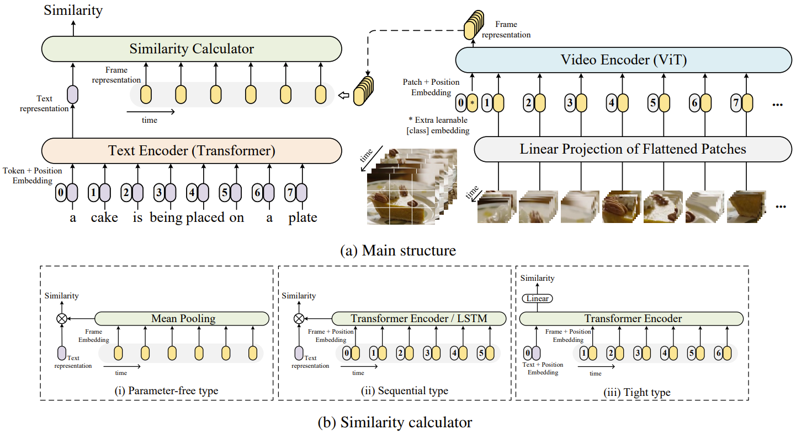

# CLIP4Clip — Compressed Domain

A variant of [CLIP4Clip](https://github.com/ArrowLuo/CLIP4Clip) exploring video
retrieval in the compressed domain. Upstream's full documentation is preserved
[below](#upstream-clip4clip).

**Components:**

| Component | Purpose |
|---|---|
| [`compressed_domain/`](compressed_domain/) | Compressed-domain dataloaders (MSR-VTT, MSVD, ActivityNet, HMDB51) and the three-stream `CLIP4ClipCompressed` model (I-frame, residual, motion vector). See [MSVD and ActivityNet](#msvd-and-activitynet-in-the-compressed-domain) |
| [`compressed_domain/evaluate/`](compressed_domain/evaluate/) | Turns an MSR-VTT sample into a portable vector database, with capacity planning and vector packing |
| [`rgb_domain/`](rgb_domain/) | CLIP4Clip training and evaluation, carried over from upstream |

`embedding_db/` is self-contained: it depends only on NumPy for storage,
packing, capacity planning and evaluation, and pulls in torch/transformers only
when it has to encode something. It does not import the rest of the repository,
and the model it runs is chosen through a registry rather than hardcoded.

---

# The embedding database

Turns a sample of MSR-VTT into a compact, portable vector database: one
normalized 512-dimensional CLIP4Clip vector per video, stored as plain `.npy`
files. No server, no index format, no hosted vector database.

The shipped database is real — 1,000 MSR-VTT test videos with captions, scoring
**R@1 = 43.40** on text-to-video retrieval, which matches the published
CLIP4Clip meanP figure for MSR-VTT-9k.

## Quickstart

Every command below, up to the [upstream section](#upstream-clip4clip), runs from
`compressed_domain/evaluate/` — where the package, its tests and the sample data
live:

```bash
cd compressed_domain/evaluate
```

```bash
pip install -r requirements-embedding.txt
```

Build the database from the vectors and split CSV already in the repo. This
loads no model and takes about a second:

```bash
python -m embedding_db import-vectors --vectors sample_database/embeddings.npy --split-csv sample_database/MSRVTT_JSFUSION_test.csv --output-dir msrvtt_1k_db --model Searchium-ai/clip4clip-webvid150k
```

Search it:

```bash
python -m embedding_db search --db msrvtt_1k_db --query "a person is playing guitar" --top-k 10
```

Use it from Python:

```python
from embedding_db import EmbeddingDatabase

db = EmbeddingDatabase("msrvtt_1k_db")
for hit in db.search_vector(query_vector, top_k=5):
    print(hit["rank"], hit["video_id"], hit["score"], hit["caption"])
```

## How much fits in a storage budget

For a 2 GiB budget at 512 dimensions, including the measured 127 bytes of
per-item metadata:

| Packing | Bytes/item | Items in 2 GiB | 1,000 items | R@1 |
|---|---:|---:|---:|---:|
| float32 | 2,175 | 987,176 | 2.1 MB | 43.40 |
| float16 | 1,151 | 1,865,140 | 1.1 MB | 43.20 |
| int8 | 643 | 3,337,820 | 0.6 MB | 42.80 |
| binary | 191 | 11,221,103 | 0.2 MB | 29.30 |

Vectors are cheap. A 2,000-item database is **0.2%** of a 2 GiB budget, and the
entire 10,000-video MSR-VTT dataset is 20 MB of float32 vectors. The budget only
begins to bind near a million items.

The packing trade-off, measured on the real vectors rather than assumed:
float16 costs 0.2 points of R@1 for half the size, int8 costs 0.6 points for a
quarter, and binary is 32x smaller but gives up 14 points — useful as a cheap
first-stage filter that a float32 pass reranks, not as the only copy.

Check any budget against your own database:

```bash
python -m embedding_db estimate --budget 2GiB --db msrvtt_1k_db
```

## Commands

| Command | Purpose | Loads a model? |
|---|---|---|
| `estimate` | Size vectors, or fit them to a storage budget | No |
| `import-vectors` | Turn a vector matrix plus a split CSV into a database | No |
| `pack` | Rewrite a database as float16, int8, or binary | No |
| `compare` | Score every packing against the stored float32 vectors | No |
| `evaluate` | Text-to-video R@1 / R@5 / R@10 / MedianR (needs a 2 MB text-vector file, see [`EMBEDDING_DB.md`](compressed_domain/evaluate/EMBEDDING_DB.md#validation)) | No |
| `search` | Text query against the database | Yes |
| `build` | Embed raw video files into a new database | Yes |
| `encoders` | List the registered encoder backends and poolings | No |

Only the two commands that need to encode something load a checkpoint.

## Configuring the model

No part of the pipeline names a model. `build` and `search` construct an encoder
through a registry, so the backend, the checkpoint (hub id **or local path**),
the cache directory, device, precision, pooling and frame preprocessing are all
configuration:

```bash
python -m embedding_db build --videos-dir /datasets/MSRVTT/MSRVTT_Videos --output-dir /storage/db --config configs/local-checkpoint.json
```

Settings resolve as **defaults < config file < explicit flags**, and land in
`manifest.json` — so `search` queries a database with the model that built it,
and `--resume` refuses to continue one under a different model or preprocessing.
Preprocessing follows the checkpoint by default (`HFClipEncoder` reads its
`preprocessor_config.json`) rather than assuming CLIP constants.

Adding a backend is a class plus a `@register_encoder("name")` decorator, with
no pipeline changes. See
[`EMBEDDING_DB.md`](compressed_domain/evaluate/EMBEDDING_DB.md#choosing-and-configuring-a-model).

## Storage layout

| File | Contents |
|---|---|
| `embeddings.npy` | `(N, D)` vectors in the manifest's packing |
| `scales.npy` | per-row float32 scales; int8 packing only |
| `completed.npy` | valid-row mask, also used for safe resume |
| `items.jsonl` | row to video id, path, and caption |
| `manifest.json` | packing, dimensions, provenance, build config |
| `benchmark.json` | timings, written by `build` |
| `failures.jsonl` | unreadable videos, written by `build` |

Recommended storage: plain files on a persistent volume. At a few megabytes
there is no case for FAISS or a hosted vector database, and exact NumPy cosine
search stays appropriate well past this scale.

## Building from raw video

To embed videos yourself instead of importing published vectors:

```bash
python -m embedding_db build --videos-dir /datasets/MSRVTT/MSRVTT_Videos --split-csv /datasets/MSRVTT/MSRVTT_train.9k.csv --output-dir /storage/msrvtt-2k-embeddings --limit 2000 --device cuda --precision float16
```

Interrupted jobs resume with the same arguments plus `--resume`. Videos are the
expensive part, not vectors: the raw MSR-VTT set is a 2.19 GB download
([friedrichor/MSR-VTT](https://huggingface.co/datasets/friedrichor/MSR-VTT)
mirrors all 10,000 clips) and the checkpoint another 605 MB, neither of which is
copied into the database.

Timing for this path has **not** been measured end to end — see
[`BENCHMARK_RESULTS.md`](compressed_domain/evaluate/BENCHMARK_RESULTS.md) for exactly what was and was not
measured.

## Tests

```bash
python -m unittest discover -s tests -v
```

56 tests. They download nothing and load no checkpoint.

## Further reading

- [`EMBEDDING_DB.md`](compressed_domain/evaluate/EMBEDDING_DB.md) — full module documentation
- [`BENCHMARK_RESULTS.md`](compressed_domain/evaluate/BENCHMARK_RESULTS.md) — measurements, and the limits of each
- [`sample_database/`](compressed_domain/evaluate/sample_database/) — the published vectors and split CSV

---

# MSVD and ActivityNet in the compressed domain

`compressed_domain/main_task_retrieval.py` trains and evaluates on MSR-VTT,
MSVD and ActivityNet, selected with `--datatype msrvtt | msvd | activity`. The
command line follows upstream CLIP4Clip's (see [How to Run](#how-to-run)), with
two differences:

- **One GPU.** Run the script directly with `python`, not through
  `torch.distributed.launch`. Upstream's `--loose_type`, `--linear_patch 2d`,
  `--sim_header meanP` and `--local_rank` are accepted so its commands parse;
  other values of the first three are rejected because this model doesn't
  implement them. A launch with more than one process stops with an error.
- **`--max_frames` counts GOPs** rather than frames: all three modalities are
  sampled from that many GOPs, spread uniformly over the video with
  `--slice_framepos 2`.

Every command below runs from `compressed_domain/`.

## Preparing the data

Each prepare module downloads what it can, re-encodes the videos to CoViAR's
MPEG-4 layout with `dataloaders/reencode.sh` (needs `ffmpeg`), and prints the
`--data_path` and `--features_path` to use. A step whose output is already on
disk is skipped.

```bash
python dataloaders/prepare_msvd_dataset.py --download-path /data/msvd
```

For MSVD, the splits and `raw-captions.pkl` come from upstream's
`msvd_data.zip`, and the videos come from the Hugging Face mirror
`friedrichor/MSVD`. Pass `--videos-dir` to use raw videos you already have.

```bash
python dataloaders/prepare_activitynet_dataset.py --download-path /data/activitynet --videos-dir /data/Activity_Videos
```

For ActivityNet, the official `train.json`, `val_1.json`, `train_ids.json` and
`val_ids.json` come from the Hugging Face mirror
`friedrichor/ActivityNet_Captions`. Videos come from `--videos-dir`, or from
`--download-videos`, which downloads the mirror's ~42 GB video tar and needs
about twice that in disk space. Only the val videos are re-encoded unless you
pass `--subsets train val`. Videos that aren't found are listed in
`missing_videos_<subset>.txt` and left out of training and evaluation.

## Evaluating

```bash
DATA_PATH=/data/activitynet
python main_task_retrieval.py --do_eval --num_thread_reader=2 \
--data_path ${DATA_PATH}/activitynet_data \
--features_path ${DATA_PATH}/mpeg4_videos \
--output_dir ckpts/ckpt_activity_retrieval_looseType --resume_model auto \
--max_words 64 --max_frames 64 --batch_size_val 16 \
--datatype activity --slice_framepos 2 \
--loose_type --linear_patch 2d --sim_header meanP \
--pretrained_clip_name ViT-B/32
```

```bash
DATA_PATH=/data/msvd
python main_task_retrieval.py --do_eval --num_thread_reader=2 \
--data_path ${DATA_PATH}/msvd_data \
--features_path ${DATA_PATH}/mpeg4_videos \
--output_dir ckpts/ckpt_msvd_retrieval_looseType --resume_model auto \
--max_words 32 --max_frames 12 --batch_size_val 16 \
--datatype msvd --slice_framepos 2 \
--loose_type --linear_patch 2d --sim_header meanP \
--pretrained_clip_name ViT-B/32
```

With `--resume_model auto`, the best checkpoint of the last training run in
`--output_dir` is evaluated. To evaluate other weights, use
`--init_model runs:/<run_id>/pytorch_model.best` or a local `.pt` path instead.
If you pass neither, the untrained model (CLIP initialisation) is evaluated.

- **ActivityNet** is paragraph-to-video retrieval. Each video's sentences are
  joined into one paragraph and matched against the whole video. It is
  evaluated on `val_1.json`, as in CLIP4Clip, because there is no test split.
- **MSVD** is evaluated on `test_list.txt` by default (`--eval_on val` for
  `val_list.txt`). Every caption is a query. Text-to-video ranks the caption's
  video. Video-to-text scores each video by its best-matching caption, as
  upstream does. Each video is decoded once, not once per caption. The saved
  `embeddings_<split>.npz` has one text row per caption, plus
  `caption_video_index`.

## Training

Replace `--do_eval --resume_model auto` with upstream's training flags. For
example, this is upstream's ActivityNet command without the
`torch.distributed.launch` prefix:

```bash
python main_task_retrieval.py --do_train --num_thread_reader=2 \
--epochs=5 --batch_size=128 --n_display=50 \
--data_path ${DATA_PATH}/activitynet_data \
--features_path ${DATA_PATH}/mpeg4_videos \
--output_dir ckpts/ckpt_activity_retrieval_looseType \
--lr 1e-4 --max_words 64 --max_frames 64 --batch_size_val 16 \
--datatype activity --feature_framerate 1 --coef_lr 1e-3 \
--freeze_layer_num 0 --slice_framepos 2 \
--loose_type --linear_patch 2d --sim_header meanP \
--pretrained_clip_name ViT-B/32
```

The best checkpoint is chosen on the val split (`val_1.json` for ActivityNet,
`val_list.txt` for MSVD). On one GPU, `--batch_size 128` with `--max_frames 64`
probably needs `--gradient_accumulation_steps` or `--grad_checkpoint` to fit in
memory.

## Tests

```bash
cd compressed_domain && python -m unittest discover -s tests -v
```

---

# Upstream CLIP4Clip

Everything below this line is the documentation of the original
[CLIP4Clip](https://github.com/ArrowLuo/CLIP4Clip) repository by Luo et al.,
kept verbatim. It describes training and evaluating the model itself, which
is unchanged in this fork.

## CLIP4Clip: An Empirical Study of CLIP for End to End Video Clip Retrieval

(**July 28, 2021**) Add ViT-B/16 with an extra `--pretrained_clip_name`

(**Apr. 22, 2021**) First version 

The implementation of paper [**CLIP4Clip: An Empirical Study of CLIP for End to End Video Clip Retrieval**](https://arxiv.org/abs/2104.08860). 

CLIP4Clip is a video-text retrieval model based on [CLIP (ViT-B)](https://github.com/openai/CLIP). We investigate three similarity calculation approaches: parameter-free type, sequential type, and tight type, in this work. The model achieve SOTA results on MSR-VTT, MSVD, LSMDC, ActivityNet, and DiDeMo.



## Requirement
```sh
# From CLIP
conda install --yes -c pytorch pytorch=1.7.1 torchvision cudatoolkit=11.0
pip install ftfy regex tqdm
pip install opencv-python boto3 requests pandas
```

## Data Preparing

**For MSRVTT**

The official data and video links can be found in [link](http://ms-multimedia-challenge.com/2017/dataset). 

For the convenience, you can also download the splits and captions by,
```sh
wget https://github.com/ArrowLuo/CLIP4Clip/releases/download/v0.0/msrvtt_data.zip
```

Besides, the raw videos can be found in [sharing](https://github.com/m-bain/frozen-in-time#-finetuning-benchmarks-msr-vtt) from *Frozen️ in Time*, i.e.,
```sh
wget https://www.robots.ox.ac.uk/~maxbain/frozen-in-time/data/MSRVTT.zip
```

**For MSVD**

Raw videos can be download from [link](https://www.cs.utexas.edu/users/ml/clamp/videoDescription/). 

The splits and `raw_captions` can be found in the wonderful job [collaborative-experts](https://github.com/albanie/collaborative-experts/blob/master/misc/datasets/msvd/README.md). For the convenience, you can also download them by,
```sh
wget https://github.com/ArrowLuo/CLIP4Clip/releases/download/v0.0/msvd_data.zip
```

**For LSMDC**

You must obtain permission from MPII to download and use the data. The download link is [here](https://sites.google.com/site/describingmovies/download).
The 1000 test clips data is [link](http://www.google.com/url?q=http%3A%2F%2Fdatasets.d2.mpi-inf.mpg.de%2FmovieDescription%2Fprotected%2Flsmdc2016%2FLSMDC16_challenge_1000_publictect.csv&sa=D&sntz=1&usg=AFQjCNGIaGVhCeb6zNfUs2UL1zNzoEtaSg). Read our paper and the [dataloader](rgb_domain/dataloaders/dataloader_lsmdc_retrieval.py) for more information.

**For ActivityNet**

The official websit has made the full dataset available on Google and Baidu drives, see more information at [here](http://activity-net.org/download.html) . The splits can be found in the job [collaborative-experts](https://github.com/albanie/collaborative-experts/tree/master/misc/datasets/activity-net).

**For DiDeMo**

Raw videos can be download from [LisaAnne/LocalizingMoments](https://github.com/LisaAnne/LocalizingMoments). The splits can be found in the job [collaborative-experts](https://github.com/albanie/collaborative-experts/tree/master/misc/datasets/didemo/README.md).


## Compress Video for Speed-up (optional)
```sh
python preprocess/compress_video.py --input_root [raw_video_path] --output_root [compressed_video_path]
```
This script will compress the video to *3fps* with width *224* (or height *224*). Modify the variables for your customization.

## How to Run 

>`--features_path` is the video root path
> 
>`--linear_patch` can be set with `2d` or `3d`
> 
> `--sim_header` can be set with `meanP`, `seqLSTM`, `seqTransf`, or `tightTransf`
> 
> `--pretrained_clip_name` can be set with `ViT-B/32` or `ViT-B/16`
> 
> `--resume_model` can be used to reload the saved optimizer state to continuely train the model, **Note**: need to set the corresponding chechpoint via `--init_model` simultaneously. 

read our paper for more details on `--linear_patch` and `--sim_header`. Test more hyperparameters for better performance. 

Download CLIP (ViT-B/32) weight,
```sh
wget -P ./modules https://openaipublic.azureedge.net/clip/models/40d365715913c9da98579312b702a82c18be219cc2a73407c4526f58eba950af/ViT-B-32.pt
```
or, download CLIP (ViT-B/16) weight,
```sh
wget -P ./modules https://openaipublic.azureedge.net/clip/models/5806e77cd80f8b59890b7e101eabd078d9fb84e6937f9e85e4ecb61988df416f/ViT-B-16.pt
```

Then, run


*The CLIP (ViT-B/32) is the default setting in the paper, replacing with the ViT-B/16 for better performance.*

### MSRVTT

```sh
DATA_PATH=[Your MSRVTT data and videos path]
python -m torch.distributed.launch --nproc_per_node=4 \
main_task_retrieval.py --do_train --num_thread_reader=0 \
--epochs=5 --batch_size=128 --n_display=50 \
--train_csv ${DATA_PATH}/MSRVTT_train.9k.csv \
--val_csv ${DATA_PATH}/MSRVTT_JSFUSION_test.csv \
--data_path ${DATA_PATH}/MSRVTT_data.json \
--features_path ${DATA_PATH}/MSRVTT_Videos \
--output_dir ckpts/ckpt_msrvtt_retrieval_looseType \
--lr 1e-4 --max_words 32 --max_frames 12 --batch_size_val 16 \
--datatype msrvtt --expand_msrvtt_sentences  \
--feature_framerate 1 --coef_lr 1e-3 \
--freeze_layer_num 0  --slice_framepos 2 \
--loose_type --linear_patch 2d --sim_header meanP \
--pretrained_clip_name ViT-B/32
```

### MSVD
```sh
DATA_PATH=[Your MSVD data and videos path]
python -m torch.distributed.launch --nproc_per_node=4 \
main_task_retrieval.py --do_train --num_thread_reader=2 \
--epochs=5 --batch_size=128 --n_display=50 \
--data_path ${DATA_PATH} \
--features_path ${DATA_PATH}/MSVD_Videos \
--output_dir ckpts/ckpt_msvd_retrieval_looseType \
--lr 1e-4 --max_words 32 --max_frames 12 --batch_size_val 16 \
--datatype msvd \
--feature_framerate 1 --coef_lr 1e-3 \
--freeze_layer_num 0 --slice_framepos 2 \
--loose_type --linear_patch 2d --sim_header meanP \
--pretrained_clip_name ViT-B/32
```

### LSMDC
```sh
DATA_PATH=[Your LSMDC data and videos path]
python -m torch.distributed.launch --nproc_per_node=4 \
main_task_retrieval.py --do_train --num_thread_reader=2 \
--epochs=5 --batch_size=128 --n_display=50 \
--data_path ${DATA_PATH} \
--features_path ${DATA_PATH}/LSMDC_Videos \
--output_dir ckpts/ckpt_lsmdc_retrieval_looseType \
--lr 1e-4 --max_words 32 --max_frames 12 --batch_size_val 16 \
--datatype lsmdc --feature_framerate 1 --coef_lr 1e-3 \
--freeze_layer_num 0  --slice_framepos 2 \
--loose_type --linear_patch 2d --sim_header meanP \
--pretrained_clip_name ViT-B/32
```

### ActivityNet
ActivityNet is regarded as video-paragraph retrieval in our setting, thus, need more GPUs (or run with multi-node).
```sh
DATA_PATH=[Your ActivityNet data and videos path]
python -m torch.distributed.launch --nproc_per_node=8 \
main_task_retrieval.py --do_train --num_thread_reader=2 \
--epochs=5 --batch_size=128 --n_display=50 \
--data_path ${DATA_PATH} \
--features_path ${DATA_PATH}/Activity_Videos \
--output_dir ckpts/ckpt_activity_retrieval_looseType \
--lr 1e-4 --max_words 64 --max_frames 64 --batch_size_val 16 \
--datatype activity --feature_framerate 1 --coef_lr 1e-3 \
--freeze_layer_num 0  --slice_framepos 2 \
--loose_type --linear_patch 2d --sim_header meanP \
--pretrained_clip_name ViT-B/32
```

### DiDeMo
DiDeMo is regarded as video-paragraph retrieval in our setting, thus, need more GPUs (or run with multi-node).
```sh
DATA_PATH=[Your DiDeMo data and videos path]
python -m torch.distributed.launch --nproc_per_node=8 \
main_task_retrieval.py --do_train --num_thread_reader=2 \
--epochs=5 --batch_size=128 --n_display=50 \
--data_path ${DATA_PATH} \
--features_path ${DATA_PATH}/DiDeMo_Videos \
--output_dir ckpts/ckpt_didemo_retrieval_looseType \
--lr 1e-4 --max_words 64 --max_frames 64 --batch_size_val 16 \
--datatype didemo --feature_framerate 1 --coef_lr 1e-3 \
--freeze_layer_num 0  --slice_framepos 2 \
--loose_type --linear_patch 2d --sim_header meanP \
--pretrained_clip_name ViT-B/32
```

## Citation
If you find CLIP4Clip useful in your work, you can cite the following paper:
```bibtex
@Article{Luo2021CLIP4Clip,
  author  = {Huaishao Luo and Lei Ji and Ming Zhong and Yang Chen and Wen Lei and Nan Duan and Tianrui Li},
  title   = {{CLIP4Clip}: An Empirical Study of CLIP for End to End Video Clip Retrieval},
  journal = {arXiv preprint arXiv:2104.08860},
  year    = {2021},
}
```

## Acknowledgments
Our code is based on [CLIP](https://github.com/openai/CLIP) and [UniVL](https://github.com/microsoft/UniVL).

---

# License and attribution

MIT, inherited from upstream CLIP4Clip (Copyright (c) 2021 ArrowLuo) — see
[`LICENSE`](rgb_domain/LICENSE). Code added in this repository is released under the same
terms.

The vectors in [`sample_database/`](compressed_domain/evaluate/sample_database/) are published by
[Searchium-ai/clip4clip-webvid150k](https://huggingface.co/Searchium-ai/clip4clip-webvid150k)
and the split CSV comes from the CLIP4Clip release data; both are redistributed
here for reproducibility, not authored by this repository.
